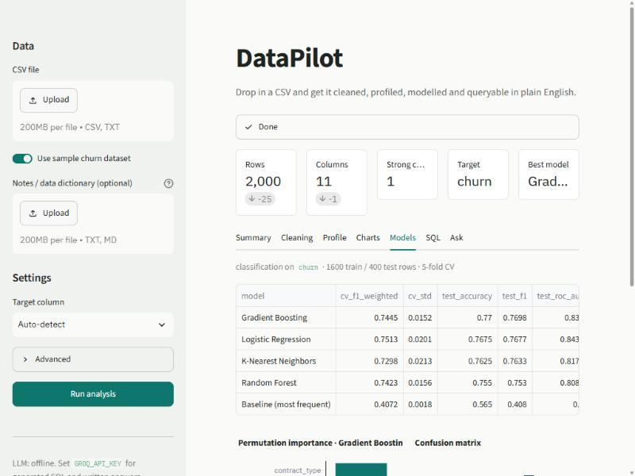

# DataPilot

A tool that takes a raw CSV and does the first few hours of a data science project for you:
cleans it, profiles it, plots it, trains a handful of models and compares them, and then lets
you ask questions about the data in plain English, either as SQL or as explanations of the analysis.

The steps are wired together as a [LangGraph](https://github.com/langchain-ai/langgraph) state
graph, and the language parts run on Llama 3.3 70B through Groq's free API.



## What it does

**Cleaning:** normalises column names, converts things like `"$1,200"` or `"yes"/"no"` into
proper types, parses dates, treats `N/A`, `-`, `?` etc. as missing, drops duplicates and
mostly-empty columns, and imputes the rest. Every change is logged so you can see what happened.

**EDA:** per-column profile, correlated pairs, IQR outliers, skew, and a list of written
findings ("`total_charges` is strongly right-skewed…"). It also detects ID columns so they don't
leak into the model.

**Charts:** picks plots based on column types (distributions, top categories, correlation
heatmap, time series if there's a date column, target breakdowns).

**Modelling:** figures out classification vs regression from the target, then trains logistic/ridge
regression, KNN, random forest and gradient boosting against a dummy baseline. Reports CV
and held-out metrics, permutation feature importance, and a confusion matrix or
predicted-vs-actual plot.

**Text-to-SQL:** the question plus the schema and a few sample rows go to the LLM, which
writes a DuckDB query. If the query fails, the error is sent back and it gets another try (up
to 3). Queries are restricted to a single `SELECT` and DuckDB's external access is switched off,
so nothing can touch the filesystem.

**Assistant:** a router node decides whether a question needs SQL, an explanation of the
model, or a lookup in the analysis results. The last one is RAG: everything the pipeline produced
(plus any notes you upload, like a data dictionary) is chunked and indexed with TF-IDF, and the
answer cites the chunks it used.

### How the graph is laid out

```
analysis:  ingest → clean → eda → visualize → train_models* → build_kb → insights
           (* skipped when there's no target column)

chat:      route ─┬─ sql      generate + run query, explain the result
                  ├─ explain  model metrics / feature importance
                  └─ rag      retrieve from the analysis, answer with citations
```

### No API key? It still works

Without `GROQ_API_KEY` set, text-to-SQL falls back to a small rule-based translator ("average X
by Y", "top 5 …", "how many …") and the assistant returns the retrieved facts instead of a
written answer. Cleaning, EDA, charts and modelling don't use the LLM at all.

## Running it

```bash
pip install -r requirements.txt
```

Get a free key at [console.groq.com](https://console.groq.com/keys), then:

```bash
export GROQ_API_KEY=gsk_...        # Windows PowerShell: $env:GROQ_API_KEY="gsk_..."
streamlit run app.py
```

There's also a CLI:

```bash
python -m datapilot sample_data/customer_churn.csv --target churn --ask "churn rate by contract type"
python -m datapilot data.csv --chat
```

and you can use it from Python:

```python
from datapilot import DataPilot

pilot = DataPilot("data.csv", target="auto")
print(pilot.state["ml"].leaderboard)
print(pilot.ask("which region has the highest churn?")["answer"])
```

## Sample data

`sample_data/customer_churn.csv` is a synthetic telecom churn dataset made by
`sample_data/make_sample.py`. It's deliberately messy: currency strings, placeholder values,
an empty column and 25 duplicate rows, so the cleaning step has something to do.

## Tests

```bash
python -m pytest tests
```

Tests run in offline mode, so they don't need a key.

## Project layout

```
datapilot/
  cleaning.py   type inference, imputation, cleaning log
  eda.py        profiling, correlations, outliers, findings
  viz.py        chart selection
  ml.py         model training and comparison
  sql.py        text-to-SQL with DuckDB
  rag.py        knowledge base + retrieval + answers
  graph.py      the two LangGraph graphs and the DataPilot class
  llm.py        Groq client wrapper
app.py          Streamlit UI
```

## Things I'd add next

- Hyperparameter tuning (Optuna) for the top model
- Swap TF-IDF for embeddings once the knowledge base gets larger
- SHAP plots for per-prediction explanations
- Support for Excel / Parquet uploads
